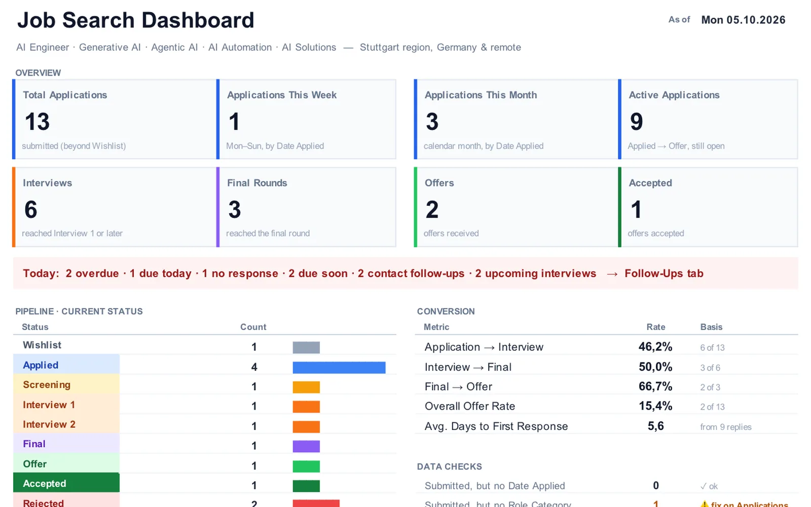
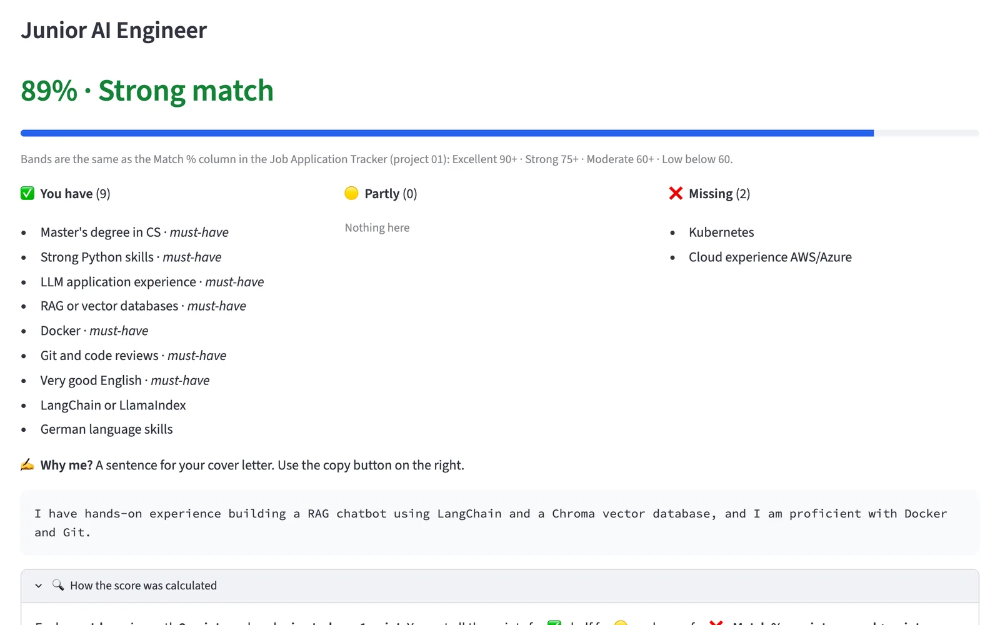
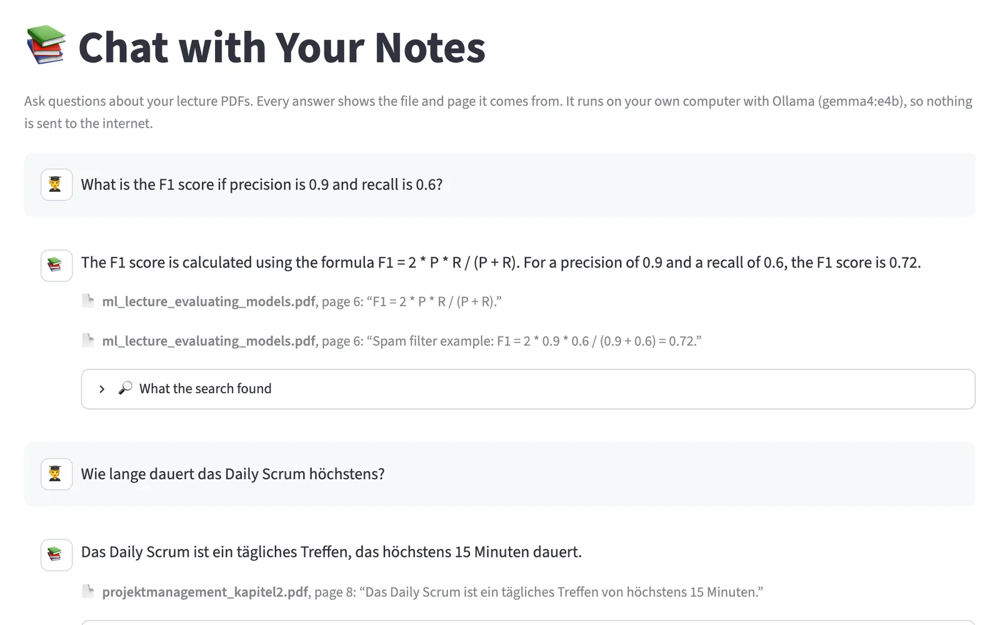
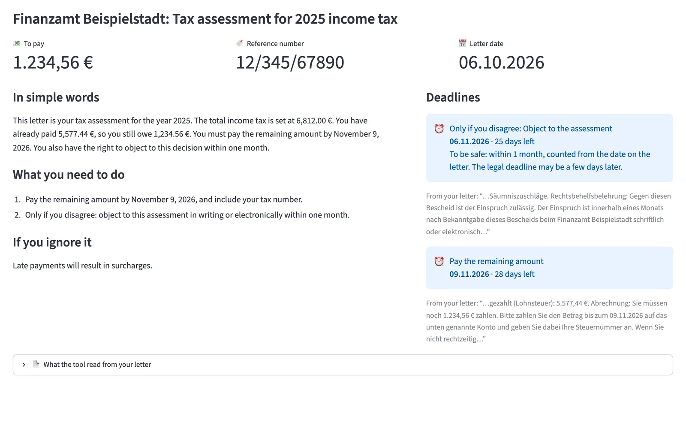
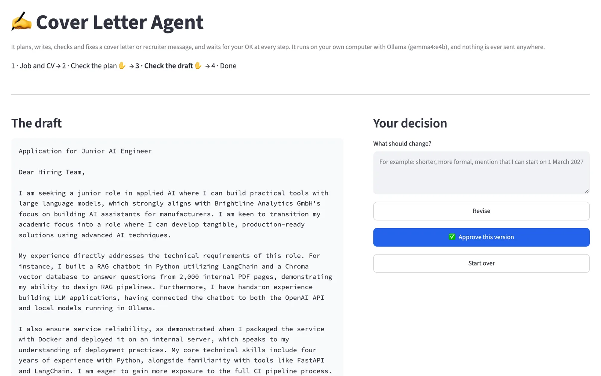
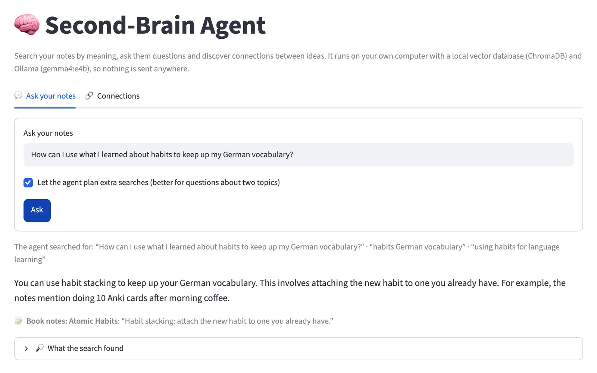
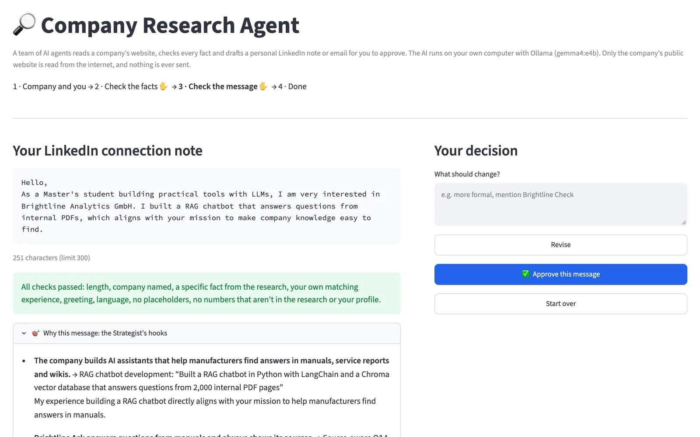

<div align="center">



<br/><br/>

[](#%EF%B8%8F-roadmap)
[](#%EF%B8%8F-roadmap)
[](https://github.com/KathiriyaHardik/ai-lab/commits/main)

[](https://github.com/KathiriyaHardik/ai-lab/commits/main)
[](https://github.com/KathiriyaHardik/ai-lab)
[](https://github.com/KathiriyaHardik/ai-lab)
[](LICENSE)
[](https://www.linkedin.com/in/hardikkathiriya/)

### Practical AI agents for real work, built in public and explained simply.

[Roadmap](#%EF%B8%8F-roadmap) · [See it in action](#-see-it-in-action) · [Start here](#-start-here) · [Skills covered](#-skills-this-lab-covers) · [How each project is built](#-how-each-project-is-built) · [Follow along](#-follow-along)

</div>

---

## 👋 About this lab

I'm **Hardik**, moving into AI engineering from Germany 🇩🇪. My Master's thesis is on Agentic AI and knowledge management.

This lab is where I learn by shipping. **I build one small AI tool at a time, and each one solves a real problem.** Then I write down exactly how I built it, so you can learn from it, copy it, or build your own.

Every project is:

- **Useful.** It solves a real problem for job seekers, students, newcomers to Germany or small businesses.
- **Small.** One working tool, not a half-finished platform.
- **Explained.** Each project's README covers what it does, how to run it and what I learned.
- **Tested.** No "it worked on my laptop once".

---

## 📊 At a glance

| 🧰 **7 tools live** | 🧪 **467 checks, all passing** | 💶 **€0 to run** | 🔒 **Private by design** |
|:---:|:---:|:---:|:---:|
| shipped between 5 and 17 October 2026 | 416 automatic checks, plus 51 quality checks with the real AI | free models in [Ollama](https://ollama.com), no account and no API key | the AI runs on your laptop, so your CV, letters and notes never leave it |

**The idea behind every tool:** the AI reads and writes, plain Python checks its work, and you make the decisions. Small AI models make mistakes, so the AI never gets the last word.

**Built with** Python · Ollama (Gemma 4, EmbeddingGemma) · ChromaDB · Streamlit · pydantic · pytest · openpyxl

---

## 🗺️ Roadmap

<p><code>▰▰▰▰▰▰▰▱</code> &nbsp;<b>7 of 8 shipped</b></p>

| # | Project | What it does | AI skill it teaches | For | Status |
|:---:|---|---|---|:---:|:---:|
| 01 | [**Job Application Tracker**](projects/01-ai-job-tracker/) | Excel / Google Sheets job-search CRM with follow-ups, pipeline, analytics and a live dashboard | Automation, data modelling, testing | 🎓 | ✅ **Live** |
| 02 | [**Job-Fit Checker**](projects/02-job-fit-checker/) | Paste a job ad and your CV. It gives a Match %, your missing skills and a "Why me?" sentence. Runs on your own computer, free | Using AI models from code, structured output, testing AI answers | 🎓 | ✅ **Live** |
| 03 | [**Chat with Your Notes**](projects/03-chat-with-notes/) | Ask questions about your lecture PDFs and get answers with page numbers. Every quote is checked, and it says so when your notes don't cover a question | RAG: AI that answers from your own documents | 📚 | ✅ **Live** |
| 04 | [**German Letter Explainer**](projects/04-letter-explainer/) | Take a photo of an official German letter. It explains what it says, what to do, every deadline with the days left and the amount to pay (not legal advice) | AI that reads images | 🌍 | ✅ **Live** |
| 05 | [**Cover Letter Agent**](projects/05-cover-letter-agent/) | Plans, writes, checks and fixes cover letters and recruiter messages in English and German, and waits for your OK at every step. Nothing is ever sent | Agents with a human in the loop | 🎓 | ✅ **Live** |
| 06 | [**Second-Brain Agent**](projects/06-second-brain/) | Searches your notes by meaning, answers questions from them and discovers connections you haven't linked yet. Works with Obsidian | Knowledge management, vector databases | 📚 | ✅ **Live** |
| 07 | [**Company Research Agent**](projects/07-company-research/) | A team of AI agents reads a company's website, checks every fact and drafts a personal LinkedIn note or email you approve | Several agents working as a team | 💼 | ✅ **Live** |
| 08 | **First Real Product** | The most popular project, turned into a small web app that real people use | Shipping, users, feedback | 🌍 | 🔜 **Next up** |

<sub>🎓 Career & job search &nbsp;·&nbsp; 📚 Students & learning &nbsp;·&nbsp; 💼 Business & sales &nbsp;·&nbsp; 🌍 Everyone</sub>

---

## 🎬 See it in action

<sub>Real screenshots with made-up sample data. Click one to open the project.</sub>

<table>
<tr>
<td width="50%" valign="top">
<a href="projects/01-ai-job-tracker/"></a>
<b>01 · Job Application Tracker</b><br/><sub>Your whole job search in one Excel workbook, with a live dashboard</sub>
</td>
<td width="50%" valign="top">
<a href="projects/02-job-fit-checker/"></a>
<b>02 · Job-Fit Checker</b><br/><sub>A Match %, your missing skills and a "Why me?" sentence</sub>
</td>
</tr>
<tr>
<td width="50%" valign="top">
<a href="projects/03-chat-with-notes/"></a>
<b>03 · Chat with Your Notes</b><br/><sub>Answers from your lecture PDFs, with the file and page</sub>
</td>
<td width="50%" valign="top">
<a href="projects/04-letter-explainer/"></a>
<b>04 · German Letter Explainer</b><br/><sub>An official letter in simple words, with every deadline</sub>
</td>
</tr>
<tr>
<td width="50%" valign="top">
<a href="projects/05-cover-letter-agent/"></a>
<b>05 · Cover Letter Agent</b><br/><sub>Plans, writes, checks and fixes, then waits for your OK</sub>
</td>
<td width="50%" valign="top">
<a href="projects/06-second-brain/"></a>
<b>06 · Second-Brain Agent</b><br/><sub>Search your notes by meaning and find new connections</sub>
</td>
</tr>
<tr>
<td width="50%" valign="top">
<a href="projects/07-company-research/"></a>
<b>07 · Company Research Agent</b><br/><sub>A team of agents researches a company and drafts your note</sub>
</td>
<td width="50%" valign="middle" align="center">
<b>🔜 08 · First Real Product</b><br/><sub>The most popular project, turned into a small web app that real people use. ⭐ Star the repo to see it ship.</sub>
</td>
</tr>
</table>

---

## 🚀 Start here

| You are… | Start with |
|---|---|
| 🎓 **Looking for a job** | [Download the Job Application Tracker](https://github.com/KathiriyaHardik/ai-lab/raw/main/projects/01-ai-job-tracker/AI_Job_Application_CRM.xlsx). It's free and ready to use in Excel or Google Sheets. Then check each job with the [Job-Fit Checker](projects/02-job-fit-checker/) before you apply, and let the [Cover Letter Agent](projects/05-cover-letter-agent/) draft your letter |
| 📚 **A student** | Add your lecture PDFs to [Chat with Your Notes](projects/03-chat-with-notes/) and ask it questions. Every answer shows the page it comes from. Keep all your notes in the [Second-Brain Agent](projects/06-second-brain/) to search them and connect ideas |
| 🌍 **New in Germany** | Take a photo of an official letter with the [German Letter Explainer](projects/04-letter-explainer/) to see what it says, what to do and by when |
| 💼 **Running a business** | Let the [Company Research Agent](projects/07-company-research/) research a company and draft a personal LinkedIn note, with every fact checked |
| 🧑‍💻 **Learning to build with AI** | Open any project folder and read its README from top to bottom. Each one explains the *why*, not just the code |
| 🧭 **A recruiter or hiring manager** | See [Skills this lab covers](#-skills-this-lab-covers). Each skill links to the project that shows it |

---

## 🧠 Skills this lab covers

| Skill | Shown in | Status |
|---|---|:---:|
| Python automation & testing | [01 Job Tracker](projects/01-ai-job-tracker/): workbook generator plus 141 automated checks run in real Excel | ✅ |
| LLM APIs & structured output | [02 Job-Fit Checker](projects/02-job-fit-checker/): local AI with Ollama, answers forced into a JSON shape, every claim checked against the CV | ✅ |
| Testing AI answers (evals) | [02 Job-Fit Checker](projects/02-job-fit-checker/): 47 fast tests with a fake AI plus 11 quality checks with the real model | ✅ |
| RAG (answers from your own documents) | [03 Chat with Your Notes](projects/03-chat-with-notes/): embeddings with EmbeddingGemma, cosine-similarity search, answers with checked quotes and page numbers, works across English and German | ✅ |
| Multimodal AI (images → text) | [04 German Letter Explainer](projects/04-letter-explainer/): the AI reads phone photos of letters (99% of words right), Python finds every date and euro amount, and the AI explains them | ✅ |
| AI agents & human-in-the-loop | [05 Cover Letter Agent](projects/05-cover-letter-agent/): plan → write → check → fix loop with tools, two human checkpoints, and a watchdog for stuck model output | ✅ |
| Vector databases & knowledge management | [06 Second-Brain Agent](projects/06-second-brain/): ChromaDB with incremental sync and tag filters, an agent that plans its searches, and connections between notes with checked quotes | ✅ |
| Multi-agent systems | [07 Company Research Agent](projects/07-company-research/): Scout, Researcher, Fact-checker, Strategist and Writer with typed handoffs and Python checks between them; a polite, robots.txt-aware web crawler | ✅ |
| Deploying a real AI product | 08 First Real Product | 🔜 |

---

## 🧱 How each project is built

Every project follows the same five steps, so you always know where to look:

```text
1. Problem     → who has this problem, and why it matters
2. Build       → the smallest version that actually works
3. Test        → automated checks, not "it worked once"
4. Explain     → README: what it does, how to run it, what I learned
5. Share       → a short build log on social media
```

```text
ai-lab/
├── assets/                    ← lab banner and gallery screenshots
└── projects/
    ├── 01-ai-job-tracker/     ✅ live
    ├── 02-job-fit-checker/    ✅ live
    ├── 03-chat-with-notes/    ✅ live
    ├── 04-letter-explainer/   ✅ live
    ├── 05-cover-letter-agent/ ✅ live
    ├── 06-second-brain/       ✅ live
    ├── 07-company-research/   ✅ live
    └── 08-first-product/      🔜 next
```

---

## 📣 Follow along

- ⭐ **Star this repo** to keep track of new projects.
- 📸 **Instagram:** launching soon, with short demos and explainers for every project.
- 💼 **LinkedIn:** the same build logs, with more detail. [Connect with me](https://www.linkedin.com/in/hardikkathiriya/).
- 🐙 **GitHub:** [@KathiriyaHardik](https://github.com/KathiriyaHardik)

Got an idea for a project, or found a bug? [Open an issue](https://github.com/KathiriyaHardik/ai-lab/issues). I read every one.

---

<div align="center">
<sub>Hardik's AI Lab · built in public from Germany 🇩🇪 · one project at a time · <a href="LICENSE">MIT licence</a>: use it, change it, share it</sub>
</div>
