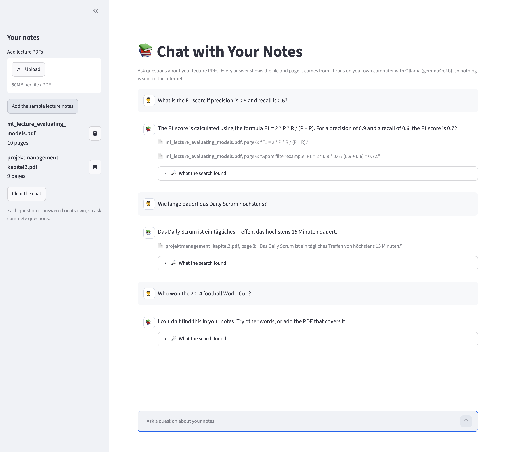

<div align="center">



<br/><br/>

[](#-quick-start)
[](#-private-by-design)
[](#-quick-start)
[](#-how-it-was-tested)

### What did the lecture say about this? · On which page? · Does it really say that?

Add your lecture PDFs and ask questions in plain English or German. Every answer shows **the file and page it comes from** and a **quote that has been checked** against that page. If your notes don't cover the question, it **says so instead of guessing**.

**The AI runs on your own computer, so your notes never leave it.** No account, no API key, no cost.

[Tour](#-tour) &nbsp;·&nbsp; [Quick start](#-quick-start) &nbsp;·&nbsp; [How it works](#-how-it-works) &nbsp;·&nbsp; [How it was tested](#-how-it-was-tested) &nbsp;·&nbsp; [What I learned](#-what-i-learned)

</div>

---

## ✨ Highlights

<table>
<tr>
<td width="33%" valign="top">

### 📄 File and page for every answer
So you can open the slide, read the context and cite it in your own work.

</td>
<td width="33%" valign="top">

### 🔍 Checked quotes
The AI must quote your notes. **Python checks every quote** is really on that page, and only checked quotes are shown.

</td>
<td width="33%" valign="top">

### 🙅 "Not in your notes"
When the notes don't answer the question, it tells you, even when the question sounds like it belongs to the course.

</td>
</tr>
<tr>
<td valign="top">

### 🇬🇧 🇩🇪 Across languages
Ask in English about German slides and it still finds the right page. Answers come in the language of your question.

</td>
<td valign="top">

### ⚡ About 3 seconds per question
Each PDF is processed once and the result is saved, so the next time you open the page your notes are ready at once.

</td>
<td valign="top">

### 🔒 Private by design
Runs with [Ollama](https://ollama.com) on your laptop. The web page only opens on your own computer and sends no usage data.

</td>
</tr>
</table>

---

## 🎬 Tour

<p align="center">
  
  <br/><sub>The two fictional sample lectures, an English and a German question, and a question the notes don't answer.</sub>
</p>

---

## 🚀 Quick start

You need a computer with **at least 16 GB of memory** (RAM). Everything below is free. I built and tested it on a Mac. Ollama, Python and Streamlit also run on Windows and Linux, but I haven't tested it there.

**1. Install Ollama and download the two AI models (one time, about 10 GB)**

Download the app from [ollama.com](https://ollama.com/download) and open it. On a Mac with Homebrew you can run `brew install --cask ollama-app` instead. Then:

```bash
ollama pull gemma4:e4b        # writes the answers (already there if you set up project 02)
ollama pull embeddinggemma    # finds the right pages (622 MB)
```

**2. Install uv** (it sets up Python and the libraries for you)

```bash
brew install uv          # Mac. For Windows and Linux, see docs.astral.sh/uv
```

**3. Start it**

```bash
cd projects/03-chat-with-notes
uv run streamlit run app.py
```

Open **http://localhost:8501**. Click **Add the sample lecture notes** to try it, or upload your own PDFs on the left.

<details>
<summary><b>⌨️ Use it from the command line instead</b></summary>
<br/>

```bash
uv run notes.py "When is the exam?" samples/*.pdf
uv run notes.py "Was ist der kritische Pfad?" ~/Documents/lectures/*.pdf
```

</details>

<details>
<summary><b>🔄 Try different AI models</b></summary>
<br/>

Other Ollama models should work too, but I've only tested `gemma4:e4b` with `embeddinggemma`. Download them, then check them with the same quality test:

```bash
NOTES_MODEL=qwen3.5:9b NOTES_EMBED_MODEL=bge-m3 uv run streamlit run app.py
uv run evaluate.py --model qwen3.5:9b --embed-model bge-m3
```

</details>

> [!TIP]
> PDFs you upload are copied to **`my-notes/`**, and what the tool learns from them is saved in **`.index/`**. Both folders are git-ignored, so your notes can't be pushed by accident.

> [!NOTE]
> **What it can't do yet:**
> - **Scanned PDFs** (pages that are only images) have no text to read.
> - **Formulas and tables** can come out of a PDF as messy text.
> - **Follow-up questions** like "and what about the second one?" don't work, because each question is answered on its own. Ask complete questions.

---

## 🔄 How it works

This is called **RAG** (retrieval-augmented generation): first *find* the right pages, then let the AI *answer from them only*.

```text
 ONCE PER PDF
 ┌──────────┐   read every page   ┌──────────┐   embedding model   ┌──────────────────┐
 │   PDFs   │ ──────────────────▶ │  chunks  │ ──────────────────▶ │ 768 numbers per  │
 └──────────┘   cut long pages    └──────────┘   (embeddinggemma)  │ chunk, saved in  │
                                                                   │ .index/          │
 FOR EVERY QUESTION                                                └────────┬─────────┘
 ┌──────────┐   same model        ┌──────────┐   most similar               │
 │ question │ ──────────────────▶ │ numbers  │ ─────────────────────────────┘
 └──────────┘                     └──────────┘   → 5 best chunks (file + page)
                                                              │
                                                              ▼
 ┌────────────────────────────────────────┐   ┌─────────────────────────────────────┐
 │ AI (gemma4) reads ONLY those 5 chunks: │──▶│ Python checks every quote is really │
 │ found? quotes? answer?                 │   │ in the chunk it names → sources     │
 └────────────────────────────────────────┘   └─────────────────────────────────────┘
```

**Embeddings in one sentence:** an embedding model turns a piece of text into a list of 768 numbers that describe what it's *about*, so texts with a similar meaning get similar numbers, even in different languages. Finding the right page means finding the closest numbers ([cosine similarity](https://en.wikipedia.org/wiki/Cosine_similarity)).

**Why "chunks"?** A whole PDF is too much to compare at once. One chunk is one slide or about half a book page (up to 1,500 characters), and it always remembers its file and page.

**Why quotes?** The AI's answer has a fixed JSON shape: `found`, then `citations` (excerpt number + exact words), then `answer`. Python looks for every quote in the excerpt it names, ignoring case, spacing and punctuation. A quote that isn't there is dropped. If none survive, the page warns you to check the answer yourself.

**Why "not found"?** The AI is told to use only the excerpts and to set `found: false` when they don't hold the answer. A wrong answer with a real-looking page number would be worse than no answer.

---

## 🔒 Private by design

- Both AI models run in Ollama on your computer. Your PDFs and questions are only sent to `localhost`.
- The web page only listens on your own computer (`server.address = "localhost"`).
- Streamlit's anonymous usage statistics are switched off in [`.streamlit/config.toml`](.streamlit/config.toml).
- Your PDFs (`my-notes/`) and their saved embeddings (`.index/`) are git-ignored.
- The sample lectures in [`samples/`](samples/) are made up. [`make_samples.py`](make_samples.py) rebuilds them.

---

## 🧪 How it was tested

**1. Fast tests (37 checks, about 2 seconds, no AI needed)**

```bash
uv run pytest
```

A fake Ollama stands in for the AI. Its fake embeddings are built from the words in each text, so the search can be tested too:

- **Reading PDFs:** page numbers match the PDF viewer, empty pages are skipped, German text survives, scanned and broken PDFs give clear errors
- **Chunks:** long pages are cut at sentence ends, with overlap, and nothing is lost
- **Search:** the right page comes first, embeddings are saved and reused (no repeat work for the same file, even after renaming it, but redone for a new embedding model)
- **Answers:** checked quotes become sources with file and page; made-up quotes and wrong excerpt numbers are dropped; "not found" works; a broken AI answer is retried once with a little randomness
- **Errors:** Ollama not running, a model not downloaded, Ollama without structured output
- **The web page:** Streamlit's `AppTest` adds the samples, asks questions, removes a file and checks the chat history

I also broke the code on purpose (accepting every quote without checking it, and sorting the search the wrong way round) to make sure the tests notice. They did.

**2. Quality test with the real AI (15 questions, about a minute)**

```bash
uv run evaluate.py
```

I wrote 15 questions with known answers before the first run: 6 English questions about the English lecture, 4 German questions about the German one, 2 English questions about the German one, and 3 questions the notes **don't** answer.

| Check | Needed | Result |
|---|:---:|:---:|
| The right page is among the 5 search results | 90% | ✅ 12 of 12 |
| The answer contains the fact | 80% | ✅ 12 of 12 |
| The answer quotes the right page | 80% | ✅ 12 of 12 |
| Says "not found" when the notes don't answer | all | ✅ 3 of 3 |
| Quotes are really in the notes | 90% | ✅ 14 of 14 |

```text
Chat model: gemma4:e4b · embedding model: embeddinggemma · 5 excerpts per question

  ✅ search  ✅ fact  ✅ page 6    4.1s  What is the F1 score if precision is 0.9 and recall is 0.6?
  ✅ search  ✅ fact  ✅ page 8    3.0s  How long is a sprint in Scrum?
  ✅ says "not found"            0.9s  Which learning rate does the course recommend for gradient descent?
  ...
The right page was the search's #1 result for 12 of 12 questions.
Average time per question: 3.1 seconds
All 5 checks passed.
```

With only **2** excerpts per question (`--k 2`) all checks still pass. The first time, the two sample PDFs (19 pages) are processed in 0.6 seconds; after that they load from `.index/` in about 0.01 seconds. Tested on a MacBook with an Apple M5 chip and 16 GB of memory.

> [!IMPORTANT]
> The sample lectures are short and clean, so this is an easy test. Real lecture PDFs have tables, formulas and hundreds of pages. Try it on your own notes, and if a question goes wrong, open **🔎 What the search found** to see whether the search or the answer was the problem.

---

## 📁 Project structure

```text
03-chat-with-notes/
├── app.py                 ← the chat page (Streamlit)
├── notes.py               ← reading PDFs, embeddings, search, answers, quote check, command line
├── evaluate.py            ← quality test with the real models (15 questions)
├── make_samples.py        ← builds the two sample lecture PDFs
├── tests/                 ← fast tests with a fake Ollama
├── samples/               ← fictional lectures: machine learning (EN) and project management (DE)
├── pyproject.toml         ← dependencies (uv)
├── .streamlit/config.toml ← keeps the page local and private
└── docs/images/           ← banner + screenshot for this README
```

---

## 💡 What I learned

- **Embeddings understand meaning, across languages.** An English question about the "daily standup meeting" scored 0.53 against the German slide about the *Daily Scrum*, and only about 0.09 against unrelated slides. No translation step needed.
- **Build the "I don't know" path on purpose.** The trickiest test question asks which learning rate the course recommends. It *sounds* like it belongs in the machine-learning lecture, but the notes never say. The AI answered "not found" instead of inventing a number from general knowledge.
- **Reuse what worked before.** From [project 02](../02-job-fit-checker/): fixed-shape JSON answers, checking the AI's quotes with plain Python, a length limit plus a retry with a little randomness, and "thinking" switched off. All of it worked here without changes.
- **Let the AI pick its evidence first.** The JSON asks for the quotes *before* the answer, so the model chooses what to rely on before it writes. That's a design choice, not something I measured against the opposite order.
- **Save work you don't need to repeat.** Embeddings are saved per file content (a SHA-256 fingerprint) and per embedding model, so reopening the page or renaming a file costs nothing.
- **Small web-page traps:** Streamlit read `2 * P * R` as *italics*, so answers are now shown exactly as written. And a question sent while the previous one was still being answered left half an entry in the chat. Now a question and its answer are saved together, only when the answer is ready.

---

<div align="center">
<sub>Part of <a href="../../">NovaWerk Lab</a> · built by <a href="https://github.com/KathiriyaHardik">Hardik Kathiriya</a> · Python × Ollama × Streamlit</sub>
</div>
