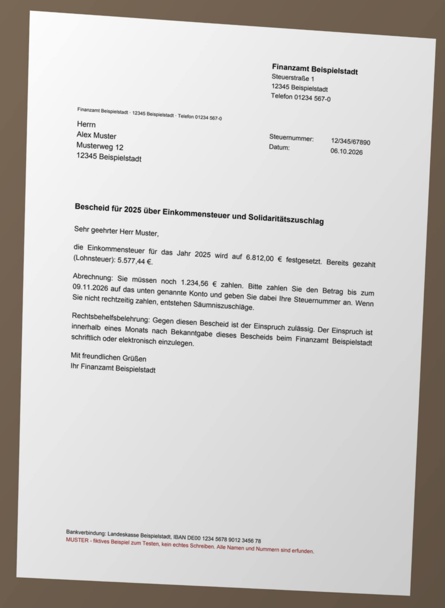
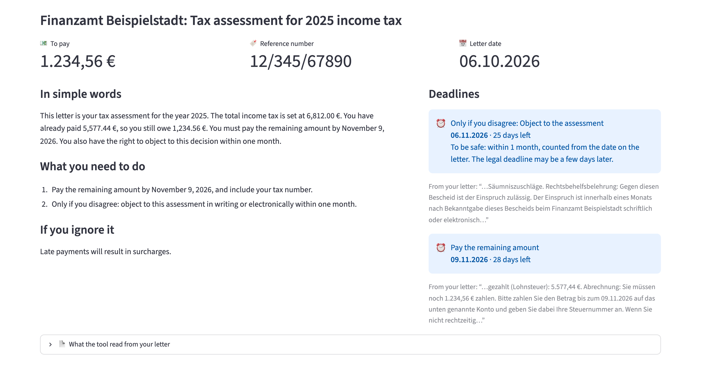

<div align="center">



<br/><br/>

[](#-quick-start)
[](#-private-by-design)
[](#-quick-start)
[](#-how-it-was-tested)

### What does this letter say? · What do I have to do? · By when?

Take a photo of an official German letter, from the tax office, the immigration office, your health insurance or your energy company. You get **what it says in simple words**, **what you have to do**, **every deadline with the days left**, and **the amount to pay**.

**The AI runs on your own computer, so your letter, with your name, address and tax number, never leaves it.** No account, no API key, no cost.

> [!CAUTION]
> **This is not legal advice.** The AI can be wrong. Always check dates and amounts on your letter, and for important letters get help from a counselling service or a lawyer ([see below](#%EF%B8%8F-where-to-get-help)).

[Tour](#-tour) &nbsp;·&nbsp; [Quick start](#-quick-start) &nbsp;·&nbsp; [How it works](#-how-it-works) &nbsp;·&nbsp; [How it was tested](#-how-it-was-tested) &nbsp;·&nbsp; [What I learned](#-what-i-learned)

</div>

---

## ✨ Highlights

<table>
<tr>
<td width="33%" valign="top">

### ⏰ Deadlines with days left
Payment dates, appointments and objection deadlines, sorted by date and coloured by how urgent they are.

</td>
<td width="33%" valign="top">

### 🛟 Safe dates
*"Innerhalb von 14 Tagen"* has no date on it. The tool counts from the date on the letter, which is earlier than the legal deadline, so you're on time.

</td>
<td width="33%" valign="top">

### 💶 The right amount
A reminder lists the bill, the fee and the total. The tool shows the **total you have to pay**, and every amount comes from the letter itself.

</td>
</tr>
<tr>
<td valign="top">

### 📷 Phone photos work
Tilted, a bit blurry, uneven light: the AI read 99% of the words of the sample photos correctly. PDFs and iPhone `.heic` photos work too.

</td>
<td valign="top">

### 🔍 Check it yourself
Every deadline shows the words from the letter it comes from, and you can see the full text the AI read next to your photo.

</td>
<td valign="top">

### 🔒 Private by design
Runs with [Ollama](https://ollama.com) on your laptop. The web page only opens on your own computer and sends no usage data.

</td>
</tr>
</table>

---

## 🎬 Tour

<table>
<tr>
<td width="28%" valign="top" align="center">

<br/><sub>A phone photo of a (fictional) tax letter…</sub>
</td>
<td valign="top" align="center">

<br/><sub>…becomes this. The objection deadline is clearly marked as optional.</sub>
</td>
</tr>
</table>

---

## 🚀 Quick start

You need a computer with **at least 16 GB of memory** (RAM). Everything below is free. I built and tested it on a Mac. Ollama, Python and Streamlit also run on Windows and Linux, but I haven't tested it there.

**1. Install Ollama and download the AI model (one time, about 10 GB)**

Download the app from [ollama.com](https://ollama.com/download) and open it. On a Mac with Homebrew you can run `brew install --cask ollama-app` instead. Then:

```bash
ollama pull gemma4:e4b        # reads photos and explains (already there if you set up project 02 or 03)
```

**2. Install uv** (it sets up Python and the libraries for you)

```bash
brew install uv          # Mac. For Windows and Linux, see docs.astral.sh/uv
```

**3. Start it**

```bash
cd projects/04-letter-explainer
uv run streamlit run app.py
```

Open **http://localhost:8501**, add a photo or PDF of your letter (all pages, in order) and click **Explain the letter**. To try it first, pick one of the five example letters.

<details>
<summary><b>⌨️ Use it from the command line instead</b></summary>
<br/>

```bash
uv run letters.py samples/letter2_stadtwerke_photo.jpg
uv run letters.py my-letter-page1.jpg my-letter-page2.jpg --language "Einfaches Deutsch"
```

</details>

> [!TIP]
> **For a good photo:** take it from straight above, in daylight, with the whole page in the picture. On an iPhone you can AirDrop the photo to your Mac; `.heic` works.
> Keep your own letters out of git: name them **`my-*`** (for example `my-letter.jpg`). Files with that name are git-ignored in this folder.

> [!NOTE]
> **What it can't do yet:**
> - **Handwriting** isn't tested, only printed letters.
> - **At most 6 pages** per letter.
> - **Explanations are tested in English only.** *Einfaches Deutsch*, Türkçe, Українська and العربية are in the menu, but I haven't checked their quality.

---

## 🔄 How it works

```text
 ┌──────────────┐  PDF with text: used as it is        ┌───────────────────────────┐
 │ photo / scan │─────────────────────────────────────▶│ the letter's text         │
 │ / PDF        │  photo or scan: the AI READS it      │ (shown to you, to compare)│
 └──────────────┘  and writes out every word           └─────────────┬─────────────┘
                                                                     │
                       Python FINDS every date, time span and € amount with patterns
                       d1 06.10.2026 · d2 09.11.2026 · p1 "eines Monats" · a3 1.234,56 €
                                                                     │
 ┌───────────────────────────────────────────────────────────────────▼─────────────┐
 │ the AI LABELS each one (deadline, appointment, objection, letter date,          │
 │ valid until, other), picks the amount to pay and explains the letter            │
 └───────────────────────────────────────────────────────────────────┬─────────────┘
                                                                     │
                       Python COUNTS the days left: dates as written, time spans
                       from the letter date (safe), "3 days before ..." not at all
```

**The AI reads, Python finds, the AI explains, Python counts.** Each part does what it's good at:

- **Reading photos** is what the AI is good at. It's a *multimodal* model, which means it understands images as well as text.
- **Finding dates and amounts** is easy for simple patterns and risky for a small AI, which sometimes skips one. So Python finds them, and the AI can only *label* what Python found. A date or amount that isn't in the letter can't appear on screen.
- **Counting days** is plain maths, so Python does it.

**Safe dates.** *"Innerhalb eines Monats nach Bekanntgabe"* means one month after you count as having *received* the letter, which is usually a few days after the date printed on it. The tool counts from the printed date instead. That's earlier, so if you act by then you're on time, and the page says so.

**Deadlines that point at another date** (*"drei Werktage vorher"*, three working days *before* the appointment) get no countdown, because the start isn't the letter date. The page shows the words from the letter instead.

---

## 🔒 Private by design

- The AI model runs in Ollama on your computer. Your letter is only sent to `localhost`.
- The web page only listens on your own computer (`server.address = "localhost"`).
- Streamlit's anonymous usage statistics are switched off in [`.streamlit/config.toml`](.streamlit/config.toml).
- All five sample letters in [`samples/`](samples/) are made up and marked *MUSTER*: the senders ("Beispielstadt"), people, numbers and bank accounts don't exist. [`make_samples.py`](make_samples.py) rebuilds them.

## ⚖️ Where to get help

The tool helps you understand a letter. It doesn't replace advice. For important letters, especially from the tax office, the immigration office, a court or debt collectors:

- **Migrationsberatung** (free counselling for immigrants, run by charities across Germany)
- **Verbraucherzentrale** (consumer advice, for bills, contracts and debt collection)
- **Lohnsteuerhilfeverein** (help with income tax, for a yearly membership fee)
- **a lawyer** (*Rechtsanwalt*). With a low income you can apply for *Beratungshilfe* at your local court.

---

## 🧪 How it was tested

**1. Fast tests (55 checks, about 2 seconds, no AI needed)**

```bash
uv run pytest
```

A fake AI plays back prepared answers, so these test all of the Python logic:

- **Finding:** dates in every common form (`09.11.2026`, `9.11.26`, `9. November 2026`), impossible dates and lookalikes (room `2.14`, `09:30 Uhr`, tax numbers), time spans in digits and words (*"eines Monats"*, *"drei Werktage vorher"*), euro amounts (`1.234,56 €`, `€ 5,00`, `100 Euro`, `12,- €`), and numbers that are *not* amounts
- **Counting:** months of different lengths and leap years, overdue and due-today deadlines, no countdown without a letter date or for "before" deadlines
- **The AI's answer:** one required label per date and time span, and only amounts Python found can be picked (an invented one is rejected and retried)
- **Reading:** PDFs with text skip the AI, photos and scanned PDF pages are read page by page, photos are turned upright and made smaller, iPhone `.heic` works, and bad files give clear errors
- **The web page:** Streamlit's `AppTest` runs an example letter and checks the amounts, deadlines, "only if you disagree", the letter text and the warnings

I also broke the code on purpose (counting "3 days before" from the letter date, and not noticing *"vorher"*) to make sure the tests notice. They did.

**2. Quality test with the real AI (11 letters, a few minutes)**

```bash
uv run evaluate.py
```

Each of the 5 sample letters as a clean scan and as a phone photo, plus the tax letter as a PDF. I wrote down the expected answers before the first run.

| Check | Needed | Result |
|---|:---:|:---:|
| Scans are read correctly (words) | 95% | ✅ 99.8% |
| Phone photos are read correctly (words) | 90% | ✅ 99.0% |
| Every deadline is found with the right date | all | ✅ 11 of 11 |
| The objection deadline is found, with its safe date | all | ✅ 3 of 3 |
| No invented deadlines (letter dates, an old invoice date, the info-only letter) | none | ✅ none |
| No countdown for "3 working days before" | none | ✅ none |
| The right amount to pay (€1,234.56, the total €91.40 not €86.40, €100) or none | 90% | ✅ 100% |
| The right letter date | 90% | ✅ 100% |
| The right reference number | 80% | ✅ 100% |
| Explained in English, not copied German | 90% | ✅ 100% |

```text
  letter1_finanzamt_photo.jpg            read 100.0% · deadlines ✅ · amount ✅ · date ✅ · ref ✅
  letter2_stadtwerke_photo.jpg           read  95.7% · deadlines ✅ · amount ✅ · date ✅ · ref ✅
  letter3_auslaenderbehoerde_photo.jpg   read 100.0% · deadlines ✅ · amount ✅ · date ✅ · ref ✅
  letter4_krankenkasse_photo.jpg         read  99.2% · deadlines ✅ · amount ✅ · date ✅ · ref ✅
  letter5_gesundheitskarte_photo.jpg     read 100.0% · deadlines ✅ · amount ✅ · date ✅ · ref –
  ...
All 10 checks passed.
```

> [!NOTE]
> **Not everything passed on the first try.** The first full run missed the reference number on the health-insurance letter (78%, needed 80%): the instructions named *Aktenzeichen* and *Kundennummer*, but not *Versichertennummer*. After naming the common German number types, all 10 checks pass. I kept the bar at 80%.

**Speed:** about **10 to 30 seconds per letter** on a MacBook with an Apple M5 chip and 16 GB of memory. The model uses about 12 GB while it reads a photo, and the time varied from run to run with how busy the Mac was.

> [!IMPORTANT]
> The sample letters are clean, typed and short. Real letters have logos, tables, small print and several pages. Try it on your own letters, compare the deadlines with the paper, and if something is wrong, open **📄 What the tool read from your letter** to see whether the reading or the explaining went wrong.

---

## 📁 Project structure

```text
04-letter-explainer/
├── app.py                 ← the web page (Streamlit)
├── letters.py             ← reading, finding dates and €, explaining, counting, command line
├── evaluate.py            ← quality test with the real AI (11 letters)
├── make_samples.py        ← builds the fictional sample letters (scan + phone photo)
├── tests/                 ← fast tests with a fake AI
├── samples/               ← 5 fictional letters as scans and photos, plus one PDF
├── pyproject.toml         ← dependencies (uv)
├── .streamlit/config.toml ← keeps the page local and private
└── docs/images/           ← banner + screenshot for this README
```

---

## 💡 What I learned

- **A small AI shouldn't find and explain at the same time.** My first version asked the AI to list every deadline itself. It missed the appointment, dropped the objection deadline, and read *"cancel three working days **before**"* as three days **after** the letter date, so the page said *"10 days ago!"*. Now Python finds every date, time span and amount, and the AI only labels them. The result: every deadline right in all 11 test runs.
- **Reading photos is the part the AI is great at.** 99% of the words on tilted, slightly blurry phone photos came out right, and every date and euro amount was correct.
- **Not every time span can be counted.** *"Within 14 days after receiving this letter"* can be counted safely from the letter date. *"Three working days before"* points at another date, so it gets no countdown at all, not a wrong one.
- **Safe beats exact for legal deadlines.** The real start of a deadline depends on rules about when a letter counts as delivered. Counting from the printed date is always a bit earlier, and the page says so.
- **Tell the model what to look for.** Adding one list of German reference-number names took the reference check from 78% to 100%.
- **Wording is a safety feature.** *"File an objection"* in a to-do list reads like an order. Now optional steps start with *"Only if you disagree"*, in the deadlines and in the to-do list.
- **Speed depends on the whole Mac, not just the code.** Reading images makes the model use about 12 of the Mac's 16 GB. The same test took about 12 seconds per letter in one run and about 30 in another, with no change to the code.

---

<div align="center">
<sub>Part of <a href="../../">Hardik’s AI Lab</a> · built by <a href="https://github.com/KathiriyaHardik">Hardik Kathiriya</a> · Python × Ollama × Streamlit · not legal advice</sub>
</div>
