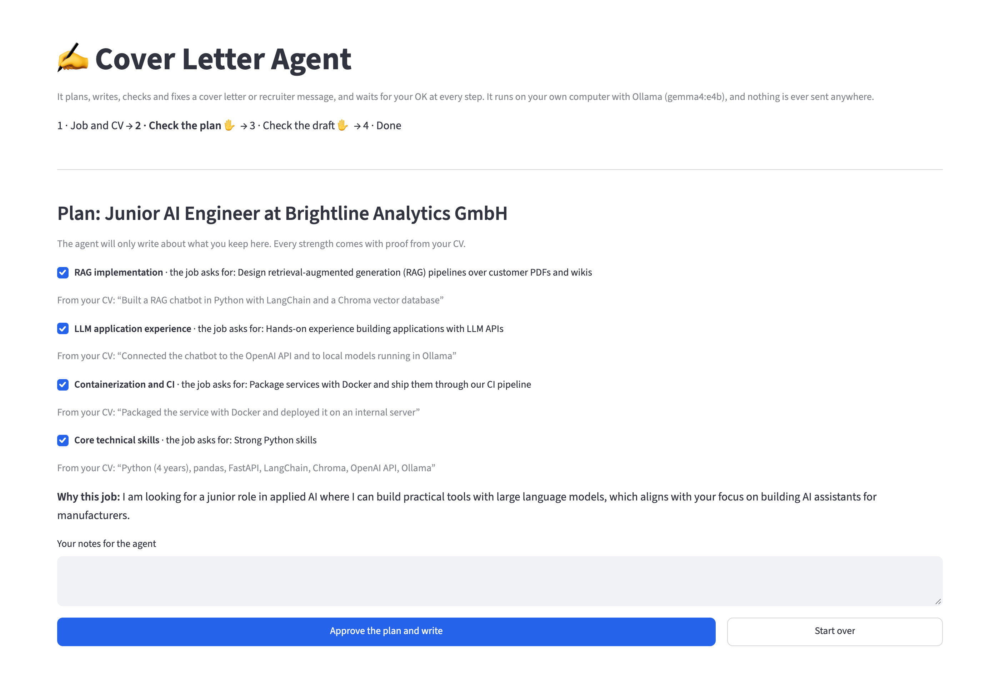
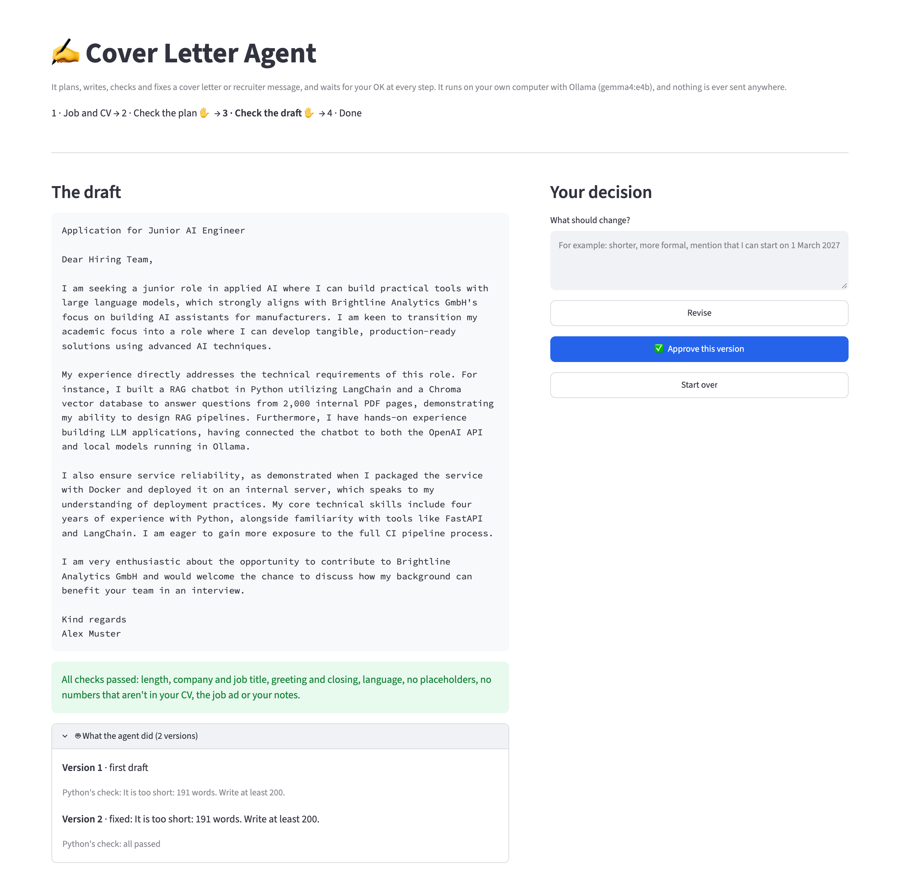

<div align="center">



<br/><br/>

[](#-quick-start)
[](#-private-by-design)
[](#-quick-start)
[](#-how-it-was-tested)

### What should I highlight? · Is every claim true? · Is it really done?

An AI **agent** that writes cover letters and short recruiter messages in English or German. It **plans** what to say, with proof from your CV. It **writes**, Python **checks** the draft, and the agent **fixes** what's wrong, all on its own. It **stops for your OK** at the two moments that matter: the plan and the final text.

**Nothing is ever sent.** You copy the text or download it (.txt or Word) and send it yourself. The AI runs on your own computer, so your CV never leaves it. No account, no API key, no cost.

[Tour](#-tour) &nbsp;·&nbsp; [Quick start](#-quick-start) &nbsp;·&nbsp; [How the agent works](#-how-the-agent-works) &nbsp;·&nbsp; [How it was tested](#-how-it-was-tested) &nbsp;·&nbsp; [What I learned](#-what-i-learned)

</div>

---

## ✨ Highlights

<table>
<tr>
<td width="33%" valign="top">

### 🗺️ A plan with proof
3 or 4 strengths that match the job, each with **the exact words from your CV** that prove it. Python checks every quote. One that isn't in your CV is switched off.

</td>
<td width="33%" valign="top">

### ✋ You decide, twice
Untick strengths, switch off the gap, add notes ("I can start on 1 March"). Then read the draft, and approve it or say what should change.

</td>
<td width="33%" valign="top">

### 🔍 It checks itself
Length, company and job title, greeting, language, placeholders like *[Company]*, empty phrases, and **no numbers that aren't in your CV, the job ad or your notes**.

</td>
</tr>
<tr>
<td valign="top">

### 🔧 It fixes itself
Problems go back to the agent automatically, up to 3 rounds. You see every version and why it changed.

</td>
<td valign="top">

### 🤝 Honest about gaps
A weak match doesn't get invented skills. In the test, a data analyst's letter for an AI job said *"I do not yet have direct experience with LLMs, RAG, or Docker"*.

</td>
<td valign="top">

### 🔒 Private by design
Runs with [Ollama](https://ollama.com) on your laptop. Approved letters are saved only in a git-ignored folder on your computer.

</td>
</tr>
</table>

---

## 🎬 Tour

<p align="center">
  
  <br/><sub><b>✋ Checkpoint 1: the plan.</b> The agent will only write about what you keep.</sub>
</p>

<p align="center">
  
  <br/><sub><b>✋ Checkpoint 2: the draft.</b> The log shows that the first version was too short, and the agent fixed it before showing it to you.</sub>
</p>

---

## 🚀 Quick start

You need a computer with **at least 16 GB of memory** (RAM). Everything below is free. I built and tested it on a Mac. Ollama, Python and Streamlit also run on Windows and Linux, but I haven't tested it there.

**1. Install Ollama and download the AI model (one time, about 10 GB)**

Download the app from [ollama.com](https://ollama.com/download) and open it. On a Mac with Homebrew you can run `brew install --cask ollama-app` instead. Then:

```bash
ollama pull gemma4:e4b        # already there if you set up projects 02 to 04
```

**2. Install uv** (it sets up Python and the libraries for you)

```bash
brew install uv          # Mac. For Windows and Linux, see docs.astral.sh/uv
```

**3. Start it**

```bash
cd projects/05-cover-letter-agent
uv run streamlit run app.py
```

Open **http://localhost:8501**. Click **Try it with an example**, or paste a job ad and upload your CV, then follow the steps: **1 Job and CV → 2 Check the plan ✋ → 3 Check the draft ✋ → 4 Done**.

<details>
<summary><b>⌨️ Use it in the terminal instead (you approve there too)</b></summary>
<br/>

```bash
uv run agent.py samples/job_ai_engineer_en.txt samples/cv_ai_student.txt
uv run agent.py my-job.txt my-cv.pdf --kind message --language Deutsch --notes "I can start on 1 March 2027"
```

The agent shows its plan and waits: press Enter to approve, or type the numbers of strengths to leave out. Then it shows the draft: press Enter to approve, or type what should change.

</details>

> [!TIP]
> Keep your own files out of git: name them **`my-*`** (for example `my-cv.pdf`). Approved letters are saved in **`my-letters/`** with their full history (plan, every version, your feedback). Both are git-ignored.

> [!NOTE]
> **Read every letter before you send it.** The agent checks facts and form, not style. Its letters can sound a bit generic, and cutting a sentence can leave a small seam (a paragraph starting with "For example" after its first sentence is gone). Add something only you would say. It was tested with fictional CVs and job ads, in English and German only.

---

## 🔄 How the agent works

```text
 job ad + CV
      │
      ▼
 ┌─────────┐ strengths + proof   ┌──────────────┐ approved plan  ┌─────────┐
 │  PLAN   │────────────────────▶│ YOU check    │───────────────▶│  WRITE  │
 │  (AI)   │ Python checks proof │ the plan     │                │  (AI)   │
 └─────────┘                     └──────────────┘                └────┬────┘
                                                                      │
                                                                      ▼
 ┌──────────────┐  approve       ┌──────────────┐  all passed    ┌─────────┐
 │ my-letters/  │◀───────────────│ YOU check    │◀───────────────│  CHECK  │
 │ .txt + Word  │                │ the draft    │                │(Python) │
 └──────────────┘                └──────┬───────┘                └──┬───▲──┘
   nothing is sent                      │ feedback        problems  │   │
                                        └──────▶ REVISE (AI) ──────▶│   │
                                                                    ▼   │
                                                      ┌─────────────────┴──┐
                                                      │ FIX, up to 3 times │
                                                      │ too long only:     │
                                                      │  AI picks, Python  │
                                                      │  cuts and counts   │
                                                      │ else: AI rewrites  │
                                                      └────────────────────┘
```

**Why this counts as an agent.** It isn't one prompt that returns a letter. The agent works in steps, uses a **tool** (Python's check) to judge its own work, **decides** what to do about the result (stop, rewrite, or cut), loops until the check passes, and **hands control back to you** at the two points where your judgement matters: what to claim, and whether the text is good enough. The steps are fixed on purpose: with a small local model, a fixed plan with clear checks is easier to make reliable than letting the model choose its own next step. That's a design choice, not something I measured, because I didn't build the other kind to compare.

**What Python checks** (the same rules are sent to the AI, so the two never contradict):

| Check | Why |
|---|---|
| Length: cover letter 200–380 words, message 45–130, or **your limit** ("at most 180 words", "höchstens 120 Wörter", "shorter") | The AI can't count words reliably. Python can. |
| The company and the job title are mentioned | Shows the letter was written for *this* job |
| Greeting and language (English or German, formal *Sie*) | A German letter starting with "Dear" is a bad first impression |
| No placeholders like *[Company]* or *XXX* | The classic mistake of letter templates |
| **No numbers that aren't in your CV, the job ad or your notes** | Catches invented facts like "5 years" or "50 projects" |
| No empty openers like *"I am writing to apply"* or *"Hiermit bewerbe ich mich"* | Recruiters skip them |

The closing (*Kind regards* or *Mit freundlichen Grüßen*, plus your name) and the comma after the greeting are added by Python, so they're always right.

---

## 🔒 Private by design

- The AI model runs in Ollama on your computer. Your CV and the job ad are only sent to `localhost`.
- The web page only listens on your own computer (`server.address = "localhost"`).
- Streamlit's anonymous usage statistics are switched off in [`.streamlit/config.toml`](.streamlit/config.toml).
- Nothing is sent by email, LinkedIn or anything else. Approved texts are saved in `my-letters/` (git-ignored), and you send them yourself.
- The sample CVs and job ads in [`samples/`](samples/) are made up. They're the same ones as in [project 02](../02-job-fit-checker/).

---

## 🧪 How it was tested

**1. Fast tests (52 checks, about 1 second, no AI needed)**

```bash
uv run pytest
```

A fake AI plays back prepared answers, so these test all of the Python logic:

- **Every check:** too short and too long, your word limits, company and job title, greeting, language, placeholders, empty phrases, and invented numbers (`2,000` and `2.000` count as the same number)
- **The plan:** proof checked against the CV, a strength without proof is switched off, repeats dropped, `ALEX MUSTER` written as `Alex Muster`
- **The loop:** problems go back to the agent, it stops after 3 rounds, the cut tool never removes the company, your start date or the final request, and a cut that removes nothing falls back to a rewrite
- **You in the loop:** only the strengths you kept reach the writer, a switched-off gap stays out, feedback is applied and its new facts may be used, and in the terminal you approve with Enter
- **Answers that go wrong:** a broken answer is retried with a little more randomness, and a model stuck writing blank lines is stopped early
- **Saving:** the .txt, the Word file, and the history file with every version
- **The web page:** Streamlit's `AppTest` clicks through plan → untick a strength → draft → feedback → approve

I also broke the code on purpose (no number check, no fix loop, no protection of important sentences) to make sure the tests notice. They did.

**2. Quality test with the real AI (6 cases, about 2 minutes)**

```bash
uv run evaluate.py
```

Five applications (English and German, cover letters and recruiter messages, and a weak match: a data analyst applying for an AI job), then one round of feedback like a person would give it: *"Make it shorter, at most 250 words, and mention that I can start on 1 March 2027."*

| Check | Needed | Result |
|---|:---:|:---:|
| The plan's strengths have real proof in the CV | 90% | ✅ 19 of 19 |
| Drafts pass every Python check after the agent's own fixing | 80% | ✅ 5 of 5 |
| No invented numbers in any final draft | none | ✅ none |
| Every draft is in the language you chose | all | ✅ all |
| The weak-match letter doesn't claim skills the CV doesn't have | none | ✅ none |
| Feedback: the start date is in the letter | yes | ✅ |
| Feedback: at most 250 words, and every check passes | yes | ✅ |
| Feedback: shorter than before | yes | ✅ (for example 230 → 189 words) |

**I ran the full test 5 times in a row: all 8 checks passed in all 5 runs.** In each run, 1 or 2 of the 5 first drafts needed the agent's fix loop (usually too short), and the loop fixed every one. An application takes about **12 to 19 seconds** on a MacBook with an Apple M5 chip and 16 GB of memory.

> [!NOTE]
> **It took four rounds of fixes to get there.** I ran the test several times after each change, and each round showed a new problem:
> 1. The AI sometimes **got stuck writing blank lines forever**, so the run stopped.
> 2. The same thing happened again in a **different step**.
> 3. *"Shorter"* **didn't make the letter shorter** (217 → 228 words). My first test missed this, because it only checked the 250-word limit.
> 4. The agent **couldn't hit an exact word count** (3 of 5 runs passed).
>
> The causes and fixes are in [What I learned](#-what-i-learned). I never lowered a threshold.

---

## 📁 Project structure

```text
05-cover-letter-agent/
├── app.py                 ← the web page: 4 steps, 2 checkpoints (Streamlit)
├── agent.py               ← plan, write, check, fix, cut, revise, approve, Word file, terminal version
├── evaluate.py            ← quality test with the real AI (6 cases)
├── tests/                 ← fast tests with a fake AI
├── samples/               ← fictional job ads (EN + DE) and CVs (strong and weak match)
├── pyproject.toml         ← dependencies (uv)
├── .streamlit/config.toml ← keeps the page local and private
└── docs/images/           ← banner + screenshots for this README
```

---

## 💡 What I learned

- **An agent is a loop with checks and checkpoints, not one big prompt.** Plan → check → write → check → fix → check is what makes the output trustworthy. The two ✋ moments are where a person's judgement matters most: *what* to claim, and *whether* it's good enough.
- **A fixed answer shape can trap a model.** Twice the AI got stuck writing blank lines until it was stopped. Both times it felt "done" while the shape still demanded another field. First it had already put the sign-off inside the paragraphs, but a separate `closing` field was still required. Later it treated *motivation* and *its proof* as one idea and stopped after the first. The fixes: Python adds the closing itself, the two fields became one, and a **watchdog** stops a reply that is only blank space and tries again.
- **Never give the AI two different rules for the same thing.** *"Shorter"* didn't work because the main instructions still said 220–340 words while the fix said "at most 196", and the AI followed the main instructions. Now both come from the same numbers.
- **The AI picks, Python counts.** Even with the right instructions, the AI landed a few words over an exact limit (3 of 5 runs passed). Now, when length is the only problem, the AI chooses *which* sentences to cut and Python removes them and counts, without ever touching the company, your start date or the final request. Result: 5 of 5.
- **Make the test as strict as the person using the tool.** "Shorter, at most 250 words" means *shorter*. My first test only checked the 250, so the letter got longer and the test still passed.
- **Run the quality test more than once.** One green run hid a problem that came back in 2 of the next 2 runs. Small local models are a little random, even at temperature 0.

---

<div align="center">
<sub>Part of <a href="../../">Hardik’s AI Lab</a> · built by <a href="https://github.com/KathiriyaHardik">Hardik Kathiriya</a> · Python × Ollama × Streamlit</sub>
</div>
