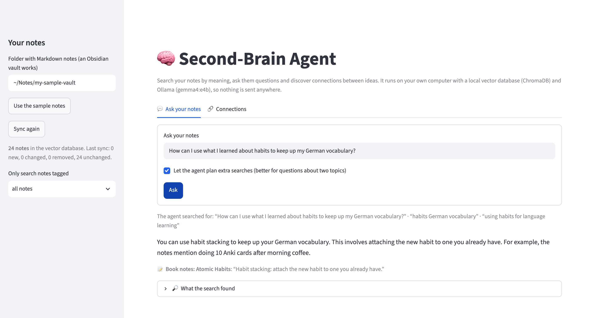
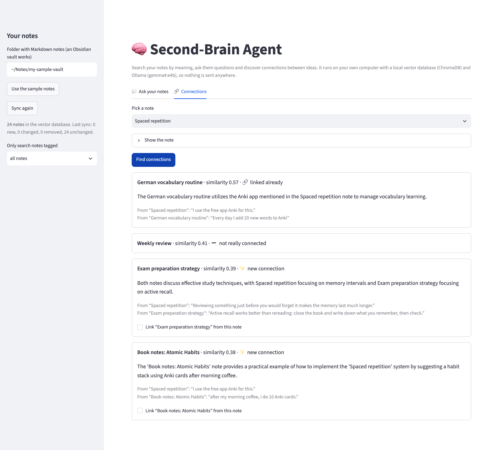

<div align="center">



<br/><br/>

[](#-quick-start)
[](#-how-it-works)
[](#-private-by-design)
[](#-quick-start)
[](#-how-it-was-tested)

### What did I already write about this? · How do my ideas fit together? · Which notes belong together?

Point it at a folder of Markdown notes (an **Obsidian** vault works). It puts them in a **vector database** on your computer, so you can **search by meaning**, **ask questions** and get answers quoted from your own notes, and **discover connections** between notes you never linked. You decide which new links to add.

**Everything runs on your own computer.** No account, no API key, no cost, and your notes never leave your laptop.

[Tour](#-tour) &nbsp;·&nbsp; [Quick start](#-quick-start) &nbsp;·&nbsp; [How it works](#-how-it-works) &nbsp;·&nbsp; [How it was tested](#-how-it-was-tested) &nbsp;·&nbsp; [What I learned](#-what-i-learned)

</div>

---

## ✨ Highlights

<table>
<tr>
<td width="33%" valign="top">

### 🗄️ A real vector database
Your notes live in [ChromaDB](https://www.trychroma.com) on your laptop, with tags for filtering. Only new or changed notes are processed again.

</td>
<td width="33%" valign="top">

### 💬 Answers from your notes
The agent plans one search per topic, answers only from what it found, and quotes the notes. If your notes don't say it, it tells you.

</td>
<td width="33%" valign="top">

### ✨ Connections you missed
For any note, see the closest ones, how they connect, with a quote from each, and which of them you **haven't linked yet**.

</td>
</tr>
<tr>
<td valign="top">

### ✋ You add the links
Tick the new connections you like, and the agent adds `[[links]]` under **## Related**. It only ever adds. It never edits or deletes your text.

</td>
<td valign="top">

### ⚡ Fast
About **2 seconds** per question on 24 sample notes. Syncing them took 0.6 seconds the first time.

</td>
<td valign="top">

### 🔒 Private by design
Ollama and ChromaDB run locally. ChromaDB's anonymous usage statistics are switched off, and so are Streamlit's.

</td>
</tr>
</table>

---

## 🎬 Tour

<p align="center">
  
  <br/><sub><b>Ask your notes.</b> The agent searched three times (the question plus two topics it planned), then answered with a checked quote.</sub>
</p>

<p align="center">
  
  <br/><sub><b>Connections.</b> One link already exists, one note is only similar in words, and two are <b>new connections</b> you can add with a click.</sub>
</p>

---

## 🚀 Quick start

You need a computer with **at least 16 GB of memory** (RAM). Everything below is free. I built and tested it on a Mac. Ollama, Python, ChromaDB and Streamlit also run on Windows and Linux, but I haven't tested it there.

**1. Install Ollama and download the two AI models (one time, about 10 GB)**

Download the app from [ollama.com](https://ollama.com/download) and open it. On a Mac with Homebrew you can run `brew install --cask ollama-app` instead. Then:

```bash
ollama pull gemma4:e4b        # answers and connections (already there if you set up projects 02 to 05)
ollama pull embeddinggemma    # meaning fingerprints for search (already there if you set up project 03)
```

**2. Install uv** (it sets up Python and the libraries for you; ChromaDB makes the first install about 600 MB)

```bash
brew install uv          # Mac. For Windows and Linux, see docs.astral.sh/uv
```

**3. Start it**

```bash
cd projects/06-second-brain
uv run streamlit run app.py
```

Open **http://localhost:8501**. Click **Use the sample notes** to try it, or type the path of your own notes folder on the left.

<details>
<summary><b>⌨️ Use it from the command line instead</b></summary>
<br/>

```bash
uv run brain.py ask "How can I use habits to keep up my German vocabulary?"
uv run brain.py related "Spaced repetition"
uv run brain.py ask "What did I write about Scrum?" --vault ~/Documents/MyVault --tag pm
```

</details>

> [!TIP]
> **Using your own Obsidian vault?** Notes in hidden folders like `.obsidian` are skipped. Tags from the front matter (`tags: [ml, ideas]`) and inline `#tags` both work, and so do links like `[[Note]]`, `[[Note|alias]]` and `[[Note#Heading]]`. When you try the sample notes, the page works on a **copy** in `my-sample-vault/`, so the originals stay as they are. The vector database lives in `.vectordb/`. Both are git-ignored.

> [!NOTE]
> **What to know:** each question is answered on its own (no follow-up questions yet). Connections are suggestions, so read both notes before you link them. It was tested on 24 short fictional notes, in English. A big vault with hundreds of long notes will be slower to sync the first time.

---

## 🔄 How it works

```text
 SYNC (once, then only what changed)
 ┌────────────┐  cut into chunks   ┌──────────────────┐  path, title, tags, hash  ┌────────────────┐
 │ your notes │───────────────────▶│ EmbeddingGemma:  │──────────────────────────▶│   ChromaDB     │
 │  (.md)     │                    │ 768 numbers each │                           │ (.vectordb/)   │
 └────────────┘                    └──────────────────┘                           └───────┬────────┘
                                                                                          │
 ASK                                                                                      │
 question ──▶ AI plans 1-3 searches ──▶ ChromaDB finds the closest chunks for each ◀──────┤
                                        ──▶ AI answers from them only, with quotes        │
                                        ──▶ Python checks every quote                     │
 CONNECT                                                                                  │
 one note ──▶ ChromaDB finds the closest notes ◀──────────────────────────────────────────┘
          ──▶ AI, one pair at a time: connected? a quote from each, one sentence on how
          ──▶ Python checks both quotes, and checks whether you linked them already
          ──▶ ✋ you tick the new ones ──▶ [[links]] added under "## Related"
```

**What a vector database adds over project 03.** In [Chat with Your Notes](../03-chat-with-notes/), Python compared the question with every chunk itself and kept the numbers in a JSON file. That's fine for a few PDFs. ChromaDB does the same job properly: it stores the vectors on disk, finds the closest ones quickly with an index (HNSW), filters by tags (`where={"tag_pm": True}`), and lets you update or delete single notes. That's what you need when notes change every day.

**Why the agent plans searches.** A question like *"How can habits help with my German vocabulary?"* is about two notes. One search finds the closest chunks to the whole question, which can miss one of the topics. So the AI first writes 1–3 short searches (*"habits German vocabulary"*, *"using habits for language learning"*), and the results are merged. When that matters is explained in [How it was tested](#-how-it-was-tested).

**Why one AI call per pair of notes.** My first version asked about four related notes in one call. The model mixed them up: the *Pomodoro* entry got an explanation about *German vocabulary*. Now each call compares exactly two notes.

---

## 🔒 Private by design

- Both AI models run in Ollama, and ChromaDB runs inside the app. Your notes are only sent to `localhost`.
- ChromaDB's anonymous telemetry is switched off (`anonymized_telemetry=False`), and it never downloads its own embedding model: it only stores the vectors EmbeddingGemma made.
- The web page only listens on your own computer, and Streamlit's usage statistics are off.
- The agent only **adds** lines under `## Related`, and only for links you ticked. It never changes or deletes your writing.
- The 24 sample notes belong to a made-up student. Each one says so in its front matter (`sample: fictional note for testing, not real`).

---

## 🧪 How it was tested

**1. Fast tests (30 checks, about 2 seconds, no AI needed)**

```bash
uv run pytest
```

A fake Ollama stands in for the AI (its fake embeddings are built from the words of each text), and a **real ChromaDB** runs in a temporary folder:

- **Reading notes:** front matter and inline tags (but not `#code` or `page#anchor`), titles, links with aliases and headings, hidden folders skipped, long notes cut at headings
- **The database:** first sync adds everything, a second one changes nothing, editing, adding and deleting a note updates exactly those, tags are stored for filtering, and each vault and model gets its own collection
- **Search and asking:** the right note comes first, tag filters work, the agent's searches are merged without repeats, made-up quotes are dropped, "not found" works, and a stuck model is stopped and retried
- **Connections:** quotes from both notes are checked, swapped quotes are put back, "not connected" is allowed, and links count in both directions and with aliases
- **Adding links:** only appends, reuses an existing "## Related" section, never adds a link twice or a link to the note itself
- **The web page:** Streamlit's `AppTest` copies the sample notes, asks a question, finds connections and adds a link

I also broke the code on purpose (not putting swapped quotes back, and not removing a changed note's old chunks before adding new ones) to make sure the tests notice. They did.

**2. Quality test with the real AI (about 2 minutes)**

```bash
uv run evaluate.py
```

Written before the first run: 10 questions answered by one note, 5 that need **two** notes, 3 the notes don't answer, related notes for 6 notes, and **4 links I left out of the notes on purpose** to see whether the agent discovers them.

| Check | Needed | Result |
|---|:---:|:---:|
| One-note questions: the right note is found | 90% | ✅ 10 of 10 |
| Two-note questions: both notes are found | 80% | ✅ 5 of 5 |
| The answer contains the fact | 80% | ✅ 15 of 15 |
| The answer quotes the right note | 80% | ✅ 15 of 15 |
| Says "not found" when the notes don't answer | all | ✅ 3 of 3 |
| Quotes really are in the notes | 90% | ✅ 20 of 20 |
| Related notes make sense (an expected note in the top 3) | 5 of 6 | ✅ 5 of 6 |
| Connections come with real quotes from both notes | 80% | ✅ 15 of 15 |
| Links I left out on purpose are discovered | 3 of 4 | ✅ 3 of 4 |

```text
  ✅ Spaced repetition: new connections ['Exam preparation strategy', 'Book notes: Atomic Habits']
  ✅ Tax ID: new connections ['Idea: German letter helper']
  ❌ Interview preparation: top 3 ['Exam preparation strategy', 'Weekly review', 'Pomodoro technique']
Average time per question (plan + search + answer): 2.3 seconds
All 9 checks passed.
```

**Where it's still weak:** *Interview preparation* was put next to *Exam preparation*, *Weekly review* and *Pomodoro*, which are notes about preparing and planning, instead of the career notes. And the planted link *Kanban board ↔ Job search plan* wasn't found: the Kanban note mentions job applications in one sentence, but the rest of it is about software tasks.

**Does the agent's search planning help?** On 24 short notes: **no difference**. One plain search found both notes for all 5 two-note questions too, because it returns 4 notes and there isn't much competition. So I repeated those 5 questions with **fewer results per search**, which is what a big vault with hundreds of similar notes feels like:

| Results per search | One plain search finds both notes | With the agent's plan |
|:---:|:---:|:---:|
| 4 (the setting the tool uses) | 5 of 5 | 5 of 5 |
| 2 | 3 of 5 | **4 of 5** |
| 1 | **0 of 5** | **3 of 5** |

Tested on a MacBook with an Apple M5 chip and 16 GB of memory.

---

## 📁 Project structure

```text
06-second-brain/
├── app.py                 ← the web page: ask and connections (Streamlit)
├── brain.py               ← notes, sync with ChromaDB, search, ask, connect, add links, command line
├── evaluate.py            ← quality test with the real AI
├── tests/                 ← fast tests with a fake AI and a real ChromaDB
├── samples/vault/         ← 24 fictional notes (learning, ML, project management, career, Germany, ideas)
├── pyproject.toml         ← dependencies (uv)
├── .streamlit/config.toml ← keeps the page local and private
└── docs/images/           ← banner + screenshots for this README
```

---

## 💡 What I learned

- **An agent step only helps where there's a real problem to solve.** The search planning made no difference on 24 notes and a big difference when results were scarce (0 → 3 of 5). I would have claimed it helps everywhere if I hadn't measured both.
- **Small models mix things up when they compare many items at once.** Four related notes in one call led to explanations about the wrong note and quotes in the wrong place. One pair per call costs a few seconds and fixes it.
- **Check the AI's quotes, then be fair about the result.** The model often put the quote from note A in note B's field. Both quotes were real, so Python now swaps them back, and both are still checked word for word.
- **Let the model say "not related".** Without that option it had to write a connection for every pair. Once it wrote *"There is no direct connection… as both are fictional sample notes"* into the connection field. Now `connected: false` is a proper answer, and the page shows "not really connected".
- **My test data can fool the AI.** I had put "Fictional sample note for testing" in the text of every note. The model then picked it up as something the notes had in common, and the same sentence in every note can also make them look more alike to the search. The label now lives in the front matter, which isn't searched.
- **Similar words aren't similar topics.** "Interview **preparation**" landed next to "Exam **preparation**". Embeddings are good, not magic. That's why you see the similarity score and the AI's judgement next to each other.

---

<div align="center">
<sub>Part of <a href="../../">Hardik’s AI Lab</a> · built by <a href="https://github.com/KathiriyaHardik">Hardik Kathiriya</a> · Python × ChromaDB × Ollama × Streamlit</sub>
</div>
