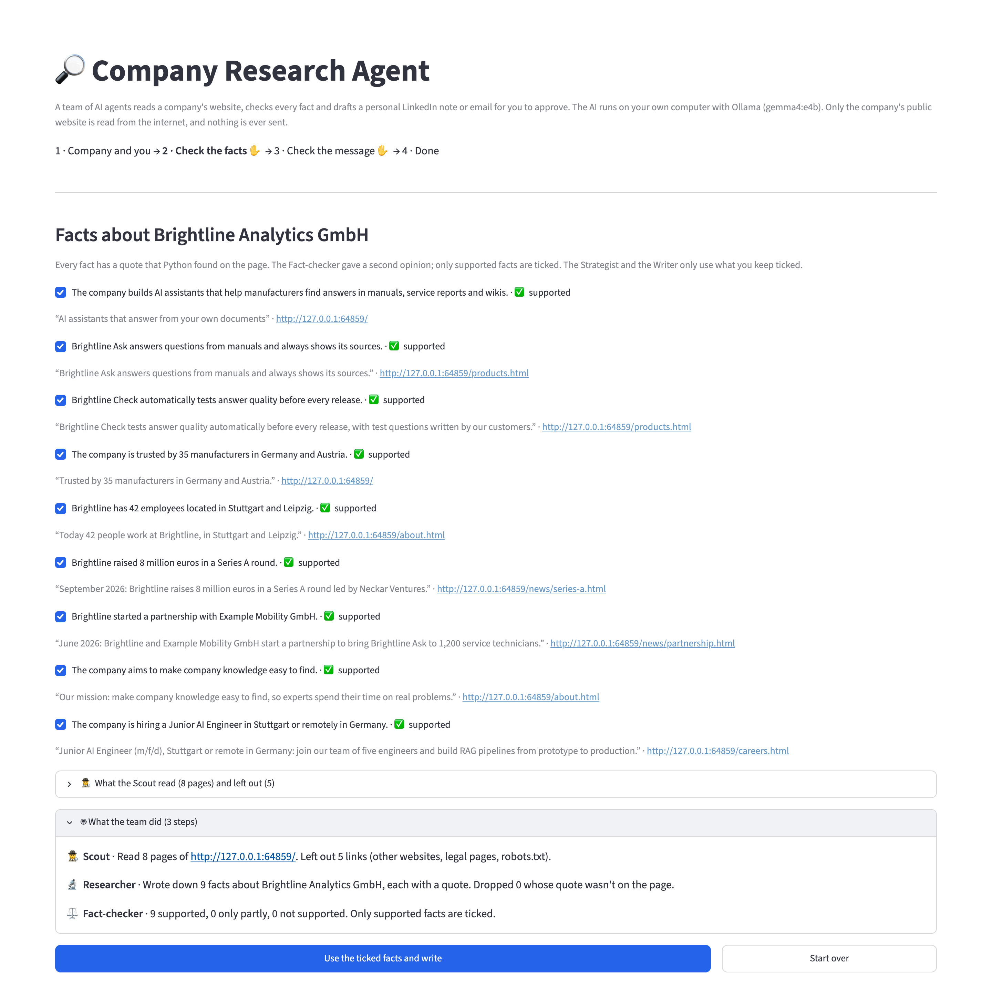
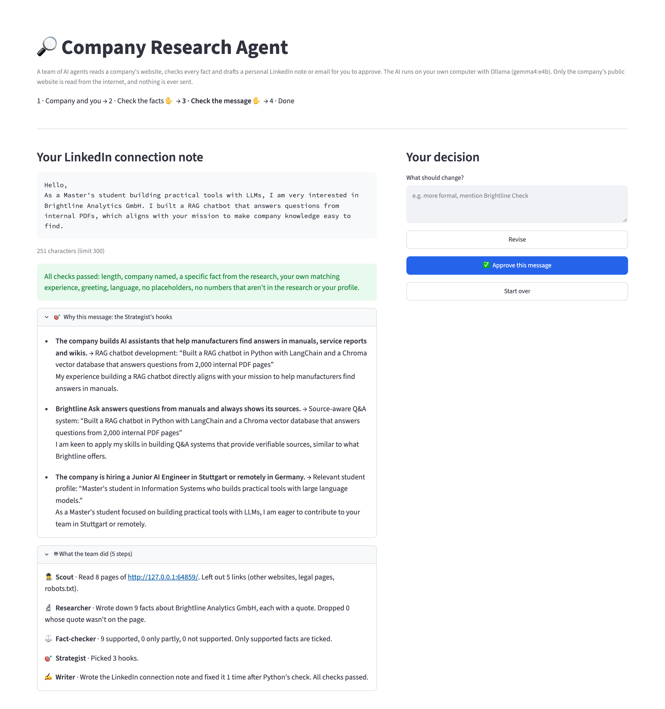

<div align="center">



<br/><br/>

[](#-quick-start)
[](#-how-the-team-works)
[](#-private-and-polite)
[](#-quick-start)
[](#-how-it-was-tested)

### What does this company do? · What do we have in common? · What do I write to them?

Give it a company's website and your CV. A **team of AI agents** reads the company's own public pages, writes down facts with quotes, **double-checks every fact**, finds where your experience matches, and drafts a short **LinkedIn note or email** in English or German, for a job, networking or business. **You approve the facts and the message. Nothing is ever sent.**

**The AI runs on your own computer.** Only the company's public website is read from the internet. No account, no API key, no cost.

[Tour](#-tour) &nbsp;·&nbsp; [Quick start](#-quick-start) &nbsp;·&nbsp; [How the team works](#-how-the-team-works) &nbsp;·&nbsp; [How it was tested](#-how-it-was-tested) &nbsp;·&nbsp; [What I learned](#-what-i-learned)

</div>

---

## ✨ Highlights

<table>
<tr>
<td width="33%" valign="top">

### 🤝 Six roles, one team
Scout, Researcher, Fact-checker, Strategist and Writer each do one job with their own instructions. You approve twice.

</td>
<td width="33%" valign="top">

### ⚖️ Facts you can trust
Every fact has a quote that Python finds on the page. A second agent asks *does the page really say that?*, and it caught **6 of 6** wrong facts planted on purpose.

</td>
<td width="33%" valign="top">

### 🎯 Personal, not generic
The Strategist pairs a company fact with *your* experience, with proof from your CV, and Python checks that the message uses it.

</td>
</tr>
<tr>
<td valign="top">

### 🕵️ Polite on the web
Only the company's own site, only what its robots.txt allows, at most 8 pages with a pause between them. It skips legal pages, and it never collects people's names.

</td>
<td valign="top">

### 🇬🇧 🇩🇪 LinkedIn or email
A LinkedIn note within 300 characters, or a short email with subject and signature, in English or German.

</td>
<td valign="top">

### 🔒 Nothing is sent
You copy the message and send it yourself. Approved messages are saved on your computer with the facts and sources they're based on.

</td>
</tr>
</table>

---

## 🎬 Tour

<p align="center">
  
  <br/><sub><b>✋ Checkpoint 1: the facts.</b> Each one with its quote and page. Only facts you keep ticked are used.</sub>
</p>

<p align="center">
  
  <br/><sub><b>✋ Checkpoint 2: the message.</b> Below it, why it says what it says, and what each agent did.</sub>
</p>

---

## 🚀 Quick start

You need a computer with **at least 16 GB of memory** (RAM). Everything below is free. I built and tested it on a Mac. Ollama, Python and Streamlit also run on Windows and Linux, but I haven't tested it there.

**1. Install Ollama and download the AI model (one time, about 10 GB)**

Download the app from [ollama.com](https://ollama.com/download) and open it. On a Mac with Homebrew you can run `brew install --cask ollama-app` instead. Then:

```bash
ollama pull gemma4:e4b        # already there if you set up projects 02 to 06
```

**2. Install uv** (it sets up Python and the libraries for you)

```bash
brew install uv          # Mac. For Windows and Linux, see docs.astral.sh/uv
```

**3. Start it**

```bash
cd projects/07-company-research
uv run streamlit run app.py
```

Open **http://localhost:8501**. Pick one of the three **fictional example companies** (their websites run on your own computer), or type a real company's website and add your CV. Then follow the steps: **1 Company and you → 2 Check the facts ✋ → 3 Check the message ✋ → 4 Done**.

<details>
<summary><b>⌨️ Use it in the terminal instead (you approve there too)</b></summary>
<br/>

```bash
uv run team.py https://www.company.example my-cv.txt
uv run team.py https://www.company.example my-cv.txt --channel email --language Deutsch --contact "Frau Beispiel"
```

</details>

> [!IMPORTANT]
> **Before you send a business message in Germany:** advertising emails to companies usually need their consent first (§7 UWG). A LinkedIn note, or a person who asked to hear from you, is the safer way. The page reminds you of this for business messages. This is not legal advice.

> [!NOTE]
> **Read every message before you send it.** The facts are checked, but the wording is the AI's. In German it sometimes makes small grammar mistakes. The Scout reads plain web pages. Sites that only show their text after running JavaScript, or that block tools in their robots.txt, can't be read. Your own files (`my-*`) and approved messages (`my-messages/`) are git-ignored.

---

## 🔄 How the team works

```text
 company website                                                  your CV
       │                                                              │
       ▼                                                              │
 ┌──────────┐ 8 pages  ┌────────────┐ facts +  ┌──────────────┐       │
 │  SCOUT   │─────────▶│ RESEARCHER │─quotes──▶│ FACT-CHECKER │       │
 │ (Python) │          │    (AI)    │ Python   │ (AI, 1 call  │       │
 └──────────┘          └────────────┘ checks   │  per fact)   │       │
   robots.txt,                        quotes   └──────┬───────┘       │
   own site only,                                     ▼               │
   no legal pages                         ┌───────────────────────┐   │
                                          │ YOU tick the facts    │   │
                                          └───────────┬───────────┘   │
                                                      ▼               ▼
 ┌──────────────┐  approve  ┌──────────────┐  ┌────────────┐  ┌────────────┐
 │ my-messages/ │◀──────────│ YOU check    │◀─│   WRITER   │◀─│ STRATEGIST │
 │ (not sent)   │           │ the message  │  │ (AI) +     │  │ (AI): fact │
 └──────────────┘           └──────┬───────┘  │ Python     │  │ + your CV  │
                                   │ feedback │ checks,    │  │ proof      │
                                   └─────────▶│ fixes x3   │  └────────────┘
                                              └────────────┘
```

**What "multi-agent" means here.** Every agent is the **same local model** (`gemma4:e4b`), but with its own job, its own instructions and its own answer shape. Python passes the work from one to the next and checks it in between. The agents don't chat with each other freely: a fixed order with checks between the steps is easier to test and to trust. That's a design choice, and I didn't build a free-chatting version to compare.

| Agent | Gets | Gives back | Python checks |
|---|---|---|---|
| 🕵️ **Scout** (no AI) | the website address | up to 8 pages of text, most useful first (about, careers, news, products) | robots.txt, same website only, no legal pages, a pause between pages |
| 🔬 **Researcher** | the pages | up to 15 facts, each with its page and an exact quote | the quote is really on that page |
| ⚖️ **Fact-checker** | one fact and its page | who says it on the page, then supported / partly / unsupported | a claim made by *someone else* is never "supported" |
| 🎯 **Strategist** | the facts you kept and your CV | 2–3 hooks: a company fact plus your matching experience | the proof is really in your CV |
| ✍️ **Writer** | the hooks, facts with the website's own words, your notes | the message | length, company named, a specific fact, your experience, greeting, language, no placeholders, no invented numbers. Problems go back up to 3 times |

---

## 🔒 Private and polite

- **The AI runs locally** in Ollama. Your CV never leaves your computer.
- **Only the company's own public website is read**, with a clear name for the tool (`HardiksAILab-CompanyResearch/1.0`), at most 8 pages, and a 1-second pause between requests.
- **robots.txt is respected.** If a site asks tools not to read it, the Scout stops.
- **No people's data:** legal and privacy pages (*Impressum*, *Datenschutz*) are skipped, and the Researcher is told not to note names. The test checks that no names end up in the facts. Who you write to is up to you: you type it in.
- **Nothing is sent.** Approved messages are saved in `my-messages/` (git-ignored) with the facts and sources.
- The three example companies, their people and their numbers are **made up**, and every page says so.

---

## 🧪 How it was tested

**1. Fast tests (48 checks, about 1 second, no AI and no internet)**

```bash
uv run pytest
```

A fake web serves the three fictional websites, and a fake AI plays every agent:

- **Scout:** useful pages first, no other websites, no legal pages, robots.txt (also "forbid everything" and "no robots.txt"), a page read only once (also after a redirect), `www.` and redirects count as the same website, a pause between requests, broken pages and unreachable sites
- **Researcher:** quotes must be on their page, repeats are dropped, only pages that exist can be cited
- **Fact-checker:** one call per fact, the whole page is shown, only "supported" facts are ticked, and a claim by someone else is never "supported"
- **Strategist:** proof must be in your CV, and only the facts you kept are used
- **Writer:** LinkedIn's 300 characters, email word limits and signature, the company name, a specific fact, your own experience, invented numbers, placeholders, empty phrases, language, the fix loop, your feedback, saving
- **You in the loop:** in the terminal and on the web page (Streamlit's `AppTest`), and a CV uploaded as PDF

I also broke the code on purpose (ignoring robots.txt, ticking every fact no matter what the Fact-checker says, not checking the Researcher's quotes) to make sure the tests notice. They did.

**2. Quality test with the real AI (the three fictional websites, 2 to 3 minutes)**

```bash
uv run evaluate.py
```

Written before the first run. Each website has traps: a page robots.txt forbids, legal pages with names, links to other sites, and a blog post quoting a claim the company *disagrees with*. I also planted 6 wrong facts (420 instead of 42 employees, Berlin instead of Munich, 6,000 instead of 600 items per hour…) for the Fact-checker to catch.

| Check | Needed | Result |
|---|:---:|:---:|
| The Scout read about, careers and news, and never legal pages, forbidden pages or other sites | all | ✅ |
| The Researcher's quotes are really on the page | 90% | ✅ 27 of 27 |
| The Researcher found the key facts (5 per company) | 12 of 15 | ✅ 15 of 15 |
| No names of people in the facts | none | ✅ none |
| A claim the company disagrees with isn't reported as its view | none | ✅ none |
| The Fact-checker caught the planted wrong facts | 5 of 6 | ✅ 6 of 6 |
| The Fact-checker doubted few correct facts | at most 25% | ✅ 1 of 27 |
| Messages pass every Python check after the Writer's fixes | 2 of 3 | ✅ 3 of 3 |

**I ran it 5 times: all 8 checks passed every time.** In the first run the Fact-checker caught 5 of 6, enough to pass, but it missed the hardest one (see [What I learned](#-what-i-learned)). After the fix it caught 6 of 6 in all 4 later runs. One company takes about **20 to 60 seconds**, depending on how busy the Mac is (MacBook with an Apple M5 chip and 16 GB of memory).

**On the real web:** I also ran the whole team once on python.org. The first try found a real bug that the fictional sites couldn't show (see below). After the fix: 8 pages read, 12 facts with **every quote on its page**, and a 178-character note that passed every check.

---

## 📁 Project structure

```text
07-company-research/
├── app.py                 ← the web page: 4 steps, 2 checkpoints (Streamlit)
├── team.py                ← the agents, Python's checks, the fix loop, saving, terminal version
├── crawler.py             ← the Scout: polite website reading, and the local sample websites
├── evaluate.py            ← quality test with the real AI on the three fictional websites
├── make_sites.py          ← builds the fictional websites
├── tests/                 ← fast tests with a fake web and a fake AI
├── samples/sites/         ← Brightline (EN), Nordlicht (DE), Neckar Robotics (EN): all fictional
├── samples/*.txt          ← a fictional CV and a fictional agency profile
├── pyproject.toml         ← dependencies (uv)
├── .streamlit/config.toml ← keeps the page local and private
└── docs/images/           ← banner + screenshots for this README
```

---

## 💡 What I learned

- **Ask the small question first.** The Fact-checker missed *"Brightline believes AI will replace half of all engineers"*: the page says *"Some say… **We disagree.**"* The instructions already said *"look at who is saying what"*, and it didn't help. What helped was a separate field, *who says it: the company or someone else?*, answered before the verdict, plus a Python rule: someone else's claim is never "supported". Then 6 of 6, in every run.
- **One fact per call, again.** Like in project 06, a small model checking many items at once mixes them up. Here every fact gets its own short call. That costs a few seconds and makes the verdicts trustworthy.
- **Test data has blind spots.** All my fictional sites lived on one address, so the Scout never met a redirect. On the real python.org, `python.org` redirected to `www.python.org`, and every link looked like *another website*: 1 page read instead of 8. Then a second detail: `/about` redirects to `/about/`, so a page was read twice. Both are fixed and have their own tests now.
- **Give the writer the original words.** The facts are written in English, so for a German email the Writer translated *"Werkstudent Generative KI"* back as *"Working Student für Generative AI"*. Passing the website's own quote along fixed the job title.
- **Being polite is part of the design.** robots.txt, a clear tool name, a page limit, pauses, skipping legal pages, no names of people, and a §7 UWG reminder for business emails. None of it makes the demo look better, but it makes the tool safe to use on real companies.
- **Multi-agent is mostly good plumbing.** The "team" is one model with five sets of instructions. What makes it work is that every handoff has a fixed shape and a Python check, just like the single agents in projects 02–06.

---

<div align="center">
<sub>Part of <a href="../../">Hardik’s AI Lab</a> · built by <a href="https://github.com/KathiriyaHardik">Hardik Kathiriya</a> · Python × Ollama × Streamlit</sub>
</div>
